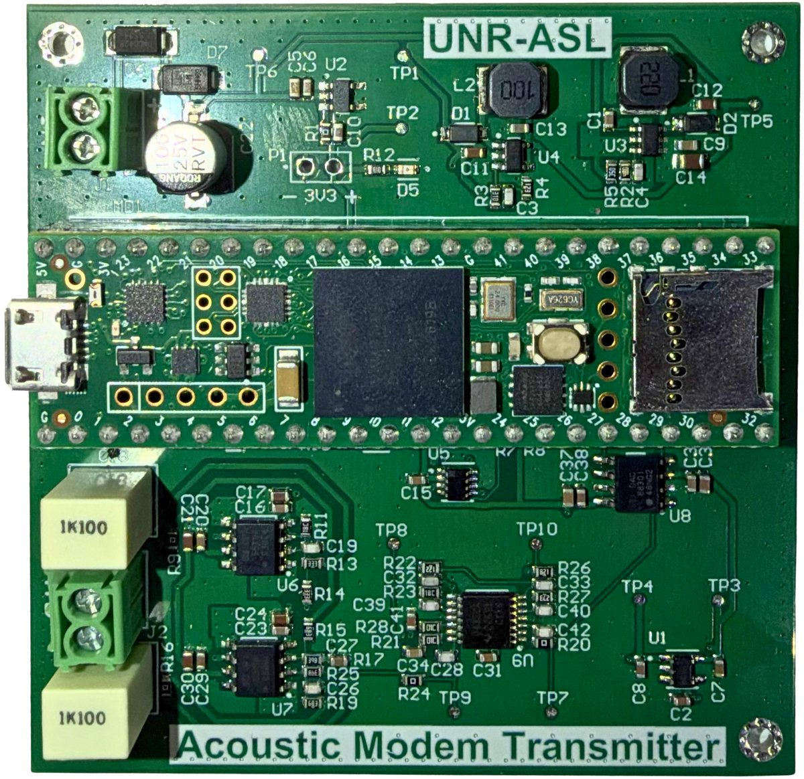
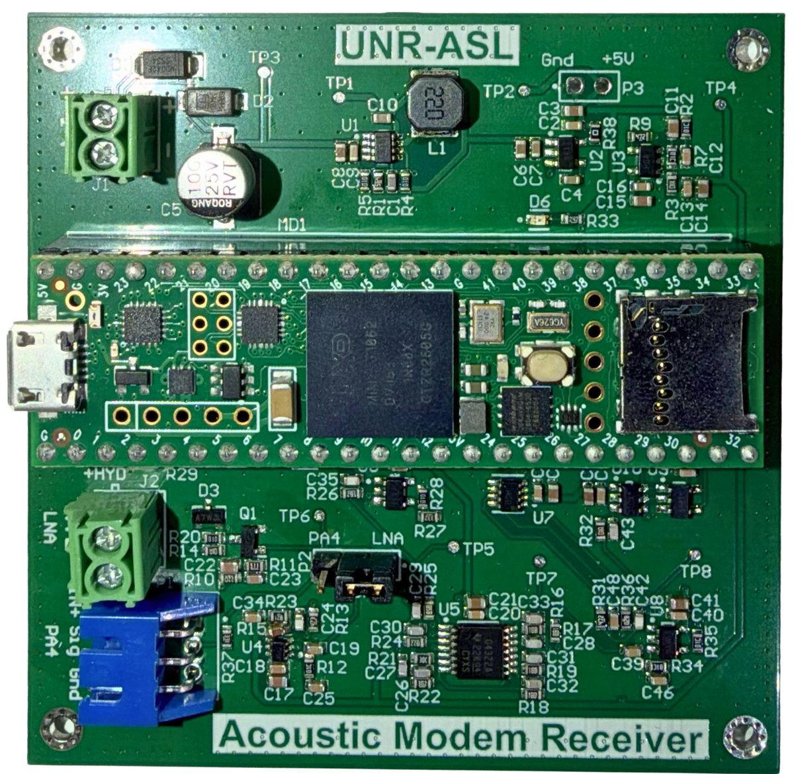
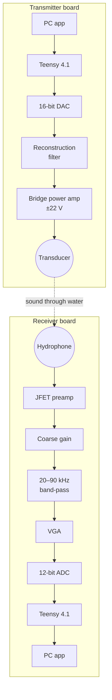
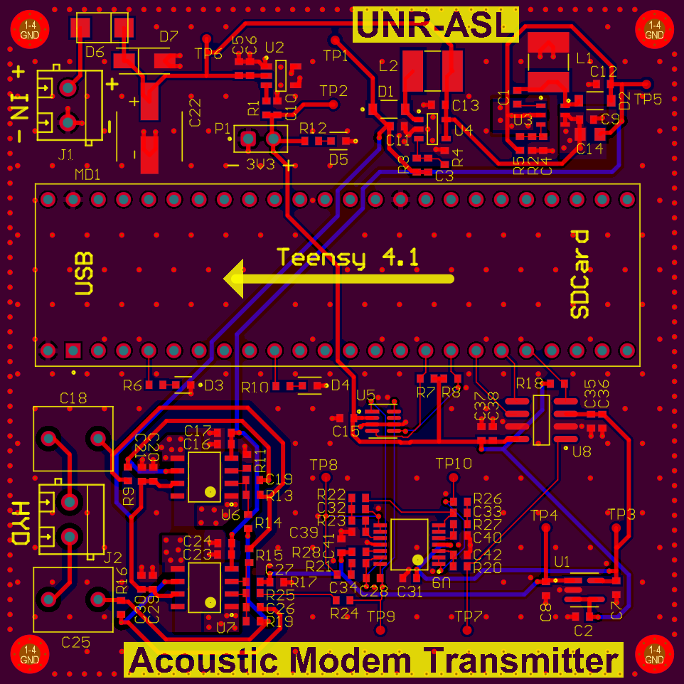
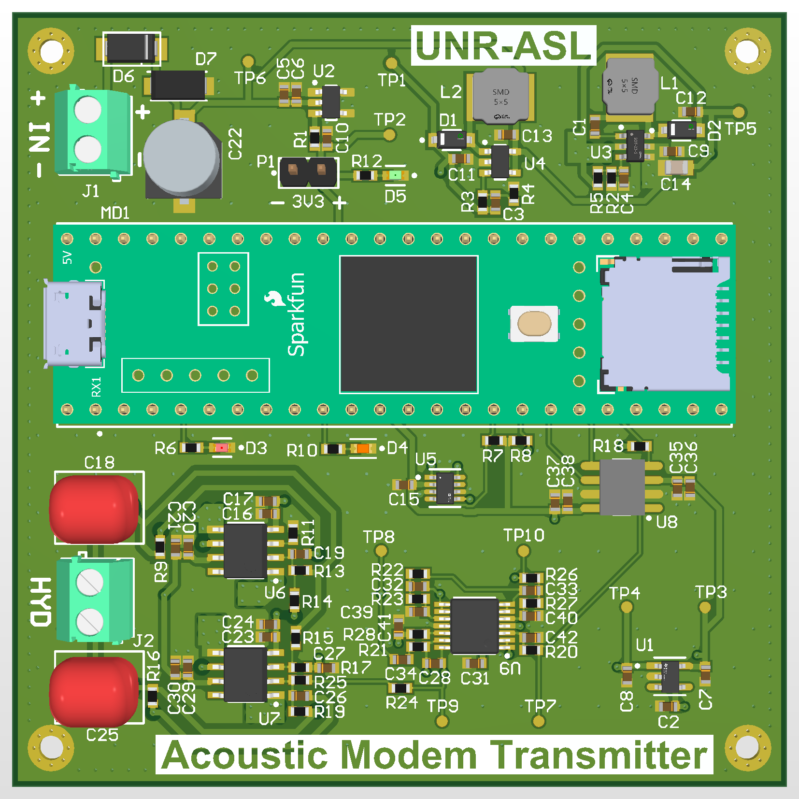
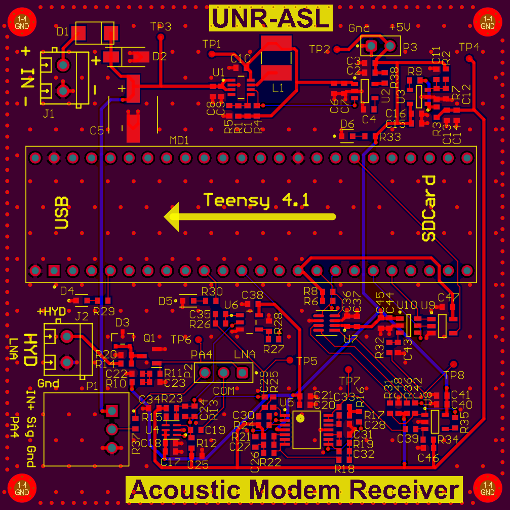
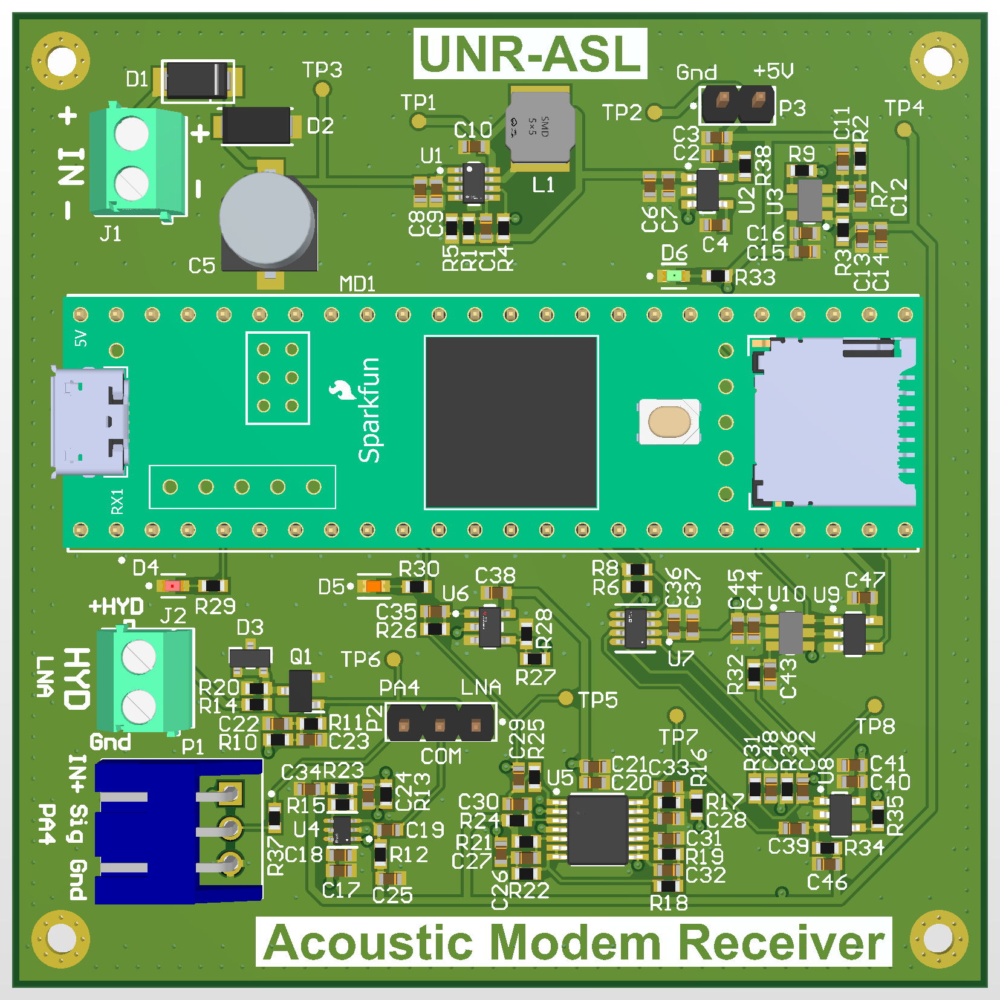
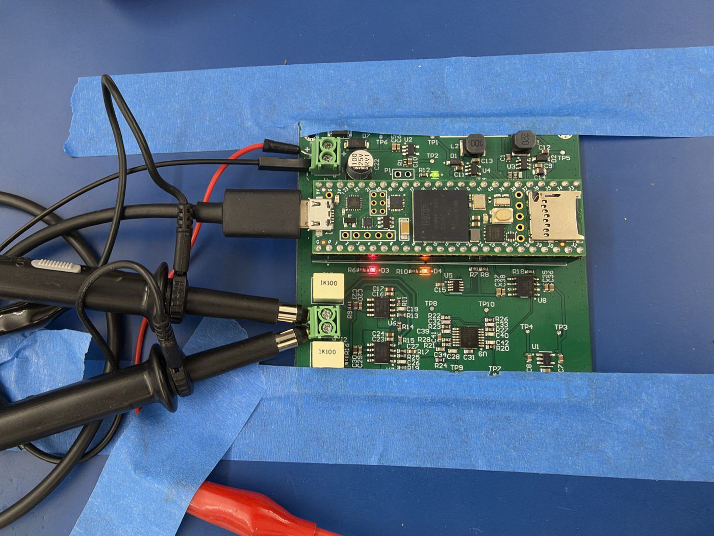
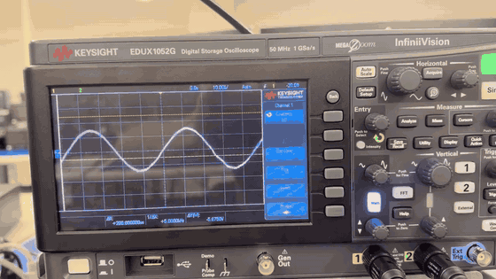
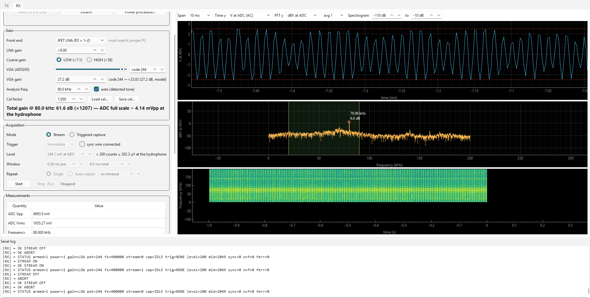

# Underwater Acoustic Modem

A two-board (TX/RX) underwater acoustic modem that sends data through water using sound at 20–90 kHz. The repo covers every layer: analog front ends, power amplifier, PCBs, firmware and a desktop test app.

**Status:** both boards brought up on the bench (power, signal chains, firmware, desktop app). In-water tests next.

<table>
  <tr>
    <td align="center"></td>
    <td align="center"></td>
  </tr>
  <tr>
    <td align="center"><b>Transmitter</b></td>
    <td align="center"><b>Receiver</b></td>
  </tr>
</table>

## What it is

Radio doesn't travel through water, so underwater links use sound. This project is a low-cost acoustic modem built from two boards, each with its own Teensy 4.1. The transmitter turns digital samples into a high-voltage drive signal for an underwater transducer. The receiver amplifies, filters and digitizes the microvolt-level signal from a hydrophone. The repo includes the schematics, simulations, 4-layer PCB designs, bench firmware, a desktop test app and the bench verification records.

## Key numbers

The left column is the design. The right column lists only what has been measured on the built hardware so far. Data rate, range and bit error rate have **not** been measured yet.

<table>
<tr><th>Design targets / specs</th><th>Measured so far</th></tr>
<tr valign="top"><td>

| | |
|---|---|
| Acoustic band | 20–90 kHz |
| TX signal generation | 16-bit DAC, 500 kS/s |
| TX power stage | Bridge amplifier, ±22 V rails generated from 12 V |
| TX output | Up to 50 Vpp differential into the transducer (firmware limit, set by the S1n's continuous rating). Amplifier headroom ≈ 76 Vpp (±19 V per leg on ±22 V rails) |
| RX preamp noise | ~1.6 nV/√Hz (JFET LNA, design estimate) |
| RX gain | ≈ 40 → 91 dB (≈ 51 dB range: 18.3 dB coarse switch + ≈ 33 dB VGA) |
| RX sampling | 12-bit ADC, 400 kS/s |
| Data rate | ≥ 10 kbps requirement, 25 kbps goal (BPSK), in progress |

</td><td>

| | |
|---|---|
| Boards | Both built and powered |
| TX rails | +22.27 V / −22.31 V. 3.294 V logic, 3.0002 V DAC reference, 1.5006 V bias |
| TX idle current | 0.08 A at 12 V |
| TX power interlock | With 12 V off, ARM is refused (`ERR NOPOWER`) and the Teensy pins stay high-impedance |
| TX output level | Level control verified up to 8.6 Vpp (no load). 50 Vpp headroom test pending |
| TX level vs gain model | Measured output 4–9 % above the model for pot codes 64–224 (14 % at code 240). Average ratio 1.085 |
| TX output, 20→90 kHz (no load) | 6.11 → 5.30 Vpp (−1.24 dB; design ≈ −0.9 dB) |
| TX tone purity, 25 kHz | All spurs ≥ 58 dB below the tone |
| TX sweep 20→90 kHz | Shown on the oscilloscope |
| RX rails and bias | All in spec. ADC idle code 2049 (expected 2048) |
| RX signal chain | Test tone passed through every stage to the PC |

</td></tr>
</table>

## System overview



The two boards have no electrical connection. They communicate only through the water. An optional sync wire links the two Teensys for bench timing measurements.

## Hardware

Both boards are 4-layer PCBs designed in Altium. They were fabricated and assembled at JLCPCB, with a few parts hand-soldered afterwards. Schematics: [TX_Board.pdf](Altium%20Projects/TX_Board/TX_Board.pdf), [RX_Board.pdf](Altium%20Projects/RX_Board/RX_Board.pdf).

### Transmitter

<p align="center">
  <br><br>
  <br>
  <em>Transmitter layout and 3D view (Altium).</em>
</p>

- **Signal generation:** a Teensy 4.1 timer interrupt drives a 16-bit DAC8830 at 500 kS/s using a 32-bit phase accumulator. It produces tones, bursts and sweeps.
- **Reconstruction filter:** 4th-order Bessel low-pass (two Sallen-Key stages, OPA4322). In the design it is flat across 20–90 kHz and down 20 dB by 410 kHz, ahead of the first DAC image at 500 kHz − f.
- **Level control:** an AD5245 digital potentiometer in the feedback path of an inverting stage, set over I²C.
- **Power amplifier:** a bridge-tied OPA552 + OPA551 pair with a differential gain of 27.31. It drives an Aquarian S1n transducer differentially, through 1 µF film DC-blocking capacitors on both legs.
- **Power:** +22 V from an LMR64010 boost, −22 V from an LMR16006 inverting buck-boost, 3.3 V from a TLV70433 LDO, and 3.000 V / 1.500 V references from a REF2030. Everything runs from a single 12 V input.

### Receiver

<p align="center">
  <br><br>
  <br>
  <em>Receiver layout and 3D view (Altium).</em>
</p>

- **Preamp:** LSK170A JFET low-noise amplifier (≈ ×9, ~1.6 nV/√Hz design estimate) for an Aquarian AS-1 hydrophone. A jumper selects an optional external PA-4 preamp instead.
- **Coarse gain:** an ADA4807 stage that firmware switches between ×58.3 and ×7.1 through an analog switch.
- **Band-pass:** a 4th-order Butterworth 20 kHz high-pass followed by a 4th-order 90 kHz low-pass.
- **VGA:** an OPA365 with an AD5245 digital potentiometer in its feedback path (≈ ×1.5 to ×68), set over I²C by the Teensy for gain control.
- **ADC:** a 12-bit ADC121S101 sampled at 400 kS/s by a top-priority timer interrupt. The firmware streams samples to the PC as CRC-protected binary frames (0.8 MB/s over USB).

## Bring-up and verification

<p align="center">
  <br>
  <em>The transmitter board on the bench during bring-up, with probes on both amplifier outputs.</em>
</p>

<p align="center">
  <br>
  <em>The transmitter sweeping the full 20 → 90 kHz band, as seen on the oscilloscope (played at 2× speed). <a href="docs/images/tx-sweep.mp4">Full-quality MP4</a>.</em>
</p>

<p align="center">
  <br>
  <em>A ≈ 3–4 mVpp test tone from a function generator, passed through every RX stage to the PC. The app shows a live waveform, FFT and spectrogram.</em>
</p>

In the screenshot, the app reports a total gain of 61.6 dB at 80 kHz (coarse gain LOW, VGA code 244). The app computes that figure from its gain model at that setting. It is not the receiver's maximum gain.

The full bench procedures and recorded measurements are in [TX_Board_Verification_Record.pdf](modem_bench/TX_Board_Verification_Record.pdf) and [RX_Board_Verification_Record.pdf](modem_bench/RX_Board_Verification_Record.pdf).

## Engineering notes

**Band-pass filter redesign.** The ahoi reference band-pass filter had about 16 dB of passband ripple across 20–90 kHz. Redesigning it as a cascaded high-pass and low-pass brought the ripple down to about 4 dB with no added parts. Both versions are in [`LTspice Simulations/Libraries/`](LTspice%20Simulations/Libraries/) (`AHOI_BPF.asc` and `RX_Cascaded_HPF_LPF.asc`).

**The 14 MHz oscillation.** At first power-up, the receiver's gain stage oscillated at 13–15 MHz. Resistor R15 sits in series with the op-amp's inverting input to balance bias currents. Its 9.1 kΩ, together with 2–3 pF of input-pin and pad capacitance, formed a pole at about 6–7 MHz inside the feedback loop. The 6.8 pF feedback capacitor keeps the loop's high-frequency gain low, so that pole left no phase margin. LTspice missed it because the model had no pin or pad capacitance. Shorting R15 stopped the oscillation, which confirmed the cause. The permanent fix is a 1 nF capacitor across R15: it removes the pole but keeps R15's DC bias-current balancing.

**ADC bit alignment caught by the self-test.** In SPI mode 0, the ADC sent four leading zero bits, not the three the spec assumed. The firmware's arming self-test caught this: the idle mid-code read 1024 instead of about 2048. A one-line firmware change (`ADC_SHIFT = 0`) fixed it, and the idle code now reads 2049.

## Repo structure

```
.
├── Altium Projects/       TX and RX board projects (schematic, PCB, output jobs, schematic PDFs) and a shared part library
├── LTspice Simulations/   Full-chain and RX simulations, LNA comparison, band-pass filter models
├── Matlab Filter Design/  Filter design live script
├── modem_bench/           Bench firmware, desktop app, tests, software specs and verification records
│   ├── tx_firmware/       Teensy 4.1 firmware for the TX board (tones, bursts, sweeps, safety interlocks)
│   ├── rx_firmware/       Teensy 4.1 firmware for the RX board (400 kS/s sampling, streaming, triggered capture)
│   ├── modem_ui/          PySide6 desktop app with TX and RX tabs
│   ├── tests/             Host-side firmware tests and simulated boards (no hardware needed)
│   ├── tools/             rx_snr.py: SNR/SINAD of a saved capture
│   └── logged_data/       Example RX capture
└── docs/images/           README images and video
```

## Getting started

### Hardware

- Open `Altium Projects/TX_Board/TX_Board.PrjPcb` or `Altium Projects/RX_Board/RX_Board.PrjPcb` in Altium Designer. Custom footprints and symbols are in `Altium Projects/Shared_Library/`.
- The schematic PDFs next to each project can be read without Altium.
- Simulations open in LTspice. The models they need are in `LTspice Simulations/Libraries/`.
- TODO: Gerber, BOM and pick-and-place files are not in the repo. They will be attached to a GitHub Release, one zip per board. Until then, generate them from each project's `.OutJob`.

### Firmware

1. Install Arduino IDE 2 and Teensyduino.
2. Under Tools, set Board to **Teensy 4.1**, USB Type to **Serial** and CPU Speed to **600 MHz**.
3. Open `modem_bench/tx_firmware/tx_firmware.ino` for the TX board or `modem_bench/rx_firmware/rx_firmware.ino` for the RX board, then upload.

Board pins stay high-impedance until the app (or the Serial Monitor) sends `ARM`, which first checks that the board is powered. Type `HELP` in the Serial Monitor for the command list.

### Desktop app

```
cd modem_bench/modem_ui
py -m venv .venv
.venv\Scripts\activate
pip install -r requirements.txt
python modem_ui.py          # real hardware
python modem_ui.py --sim    # simulated TX and RX boards, no hardware needed
```

Power order matters, and it differs between the boards:

- **TX:** turn on 12 V (current limit ≥ 0.5 A), then Connect, Arm and Start. Shut down with Stop, then Disarm, then 12 V off.
- **RX:** turn on 12 V (limit ≈ 0.2 A) and wait for LED D6 to light, then plug in USB, Connect and Arm. Shut down with Stop, then Disarm, then unplug USB, then 12 V off.

See [modem_bench/README.md](modem_bench/README.md) for details.

### Tests (no hardware)

```
python modem_bench/tests/run_all.py
```

The firmware tests need `g++` (MSYS2/MinGW), and the app tests need the packages in `requirements.txt`. The tests run the firmware against host stubs and drive the app against simulated boards.

## Roadmap

- [x] Design, fabricate and assemble the TX and RX boards
- [x] Bench bring-up: power rails, signal chains, firmware and the desktop app
- [ ] TX 50 Vpp headroom test and in-air hydrophone tests
- [ ] Modulation and demodulation (BPSK)
- [ ] Reach the 25 kbps goal (≥ 10 kbps requirement)
- [ ] Tank test
- [ ] Lake test at Lake Tahoe
- [ ] Publish measured data rate, range and bit error rate

## Acknowledgments

- Dr. Hao Xu and the Autonomous Systems Laboratory, University of Nevada, Reno.
- The open-source ahoi acoustic modem from Hamburg University of Technology (TUHH). This design started from the ahoi reference design, with these changes:
  - separate TX and RX boards and transducers (ahoi shares one)
  - a Teensy 4.1 controller
  - a new LSK170A JFET LNA (the original JFET is obsolete)
  - a cascaded high-pass + low-pass band-pass in place of ahoi's resonant filter (16 → 4 dB ripple)
  - firmware-controlled coarse gain (not populated in ahoi)
  - a PA-4 front-end option
  - a single-ground-plane layout
  - back-feed-safe arming

## Author

**Sakar Pathak**, Autonomous Systems Laboratory, University of Nevada, Reno, Fall 2026.

[Portfolio](https://www.pathaksakar.com.np/#uw-modem) · [LinkedIn](https://linkedin.com/in/sakar-pathak)
